  

  

<table border="0" cellspacing="12" cellpadding="0">
<tr>
<td></td>
<td></td>
</tr>
<tr>
<td></td>
<td></td>
</tr>
<tr>
<td></td>
<td></td>
</tr>
</table>

 

<a href="https://apasih.com">apasih.com</a> &nbsp;·&nbsp; <a href="https://github.com/b3n3d1ck">github.com/b3n3d1ck</a>

  

<picture>
  <source media="(prefers-color-scheme: dark)" srcset="https://raw.githubusercontent.com/b3n3d1ck/b3n3d1ck/output/snake-dark.svg">
  <source media="(prefers-color-scheme: light)" srcset="https://raw.githubusercontent.com/b3n3d1ck/b3n3d1ck/output/snake.svg">
  
</picture>

